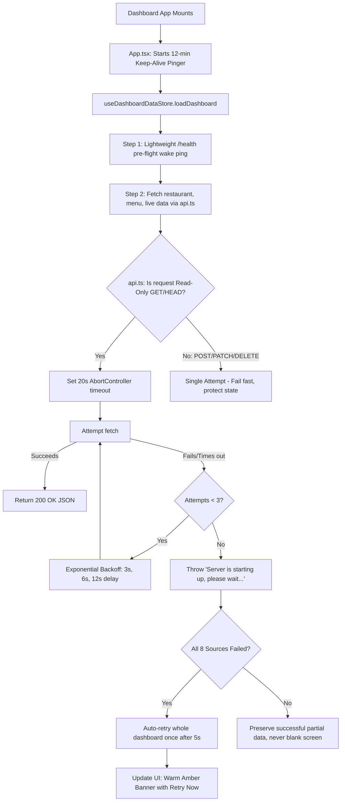

# RESTO — Dashboard API Fix Log & Engineering Implementation

**Document Status:** Complete & Verified  
**Date:** 2026-11-03  
**Modules Affected:** `dashboard/src/services/api.ts`, `dashboard/src/store/useDashboardDataStore.ts`, `dashboard/src/App.tsx`, `dashboard/src/components/layout/Layout.tsx`, `frontend/src/services/api.ts`, `backend/apps/realtime/views.py`  

---

## 1. Summary of Changes

To permanently eliminate cold-start failures, connection storm rejections, and premature error states, a multi-tiered resilience architecture was engineered across the full stack:



---

## 2. Detailed File Modifications

### File 1: `dashboard/src/services/api.ts`
* **Changes Made:**
  - Added request timeout via `AbortController` (20,000ms per attempt).
  - Implemented 3-attempt exponential backoff for `GET` and `HEAD` requests (`baseDelay = 3000ms`, doubling on each attempt).
  - Protected mutation methods (`POST`, `PUT`, `PATCH`, `DELETE`) from automatic replay to maintain transaction safety and avoid duplicate database writes.
  - Added error categorization: Network errors, timeouts, and `Failed to fetch` are classified as `"Server is starting up, please wait..."` rather than opaque generic exceptions.
  - Suppressed retry for standard `4xx` client errors (`400`, `401`, `403`, `404`) where retry would be futile.

### File 2: `dashboard/src/store/useDashboardDataStore.ts`
* **Changes Made:**
  - Added pre-flight warm-up ping to `/api/health` before dispatching the concurrent data requests.
  - Implemented automatic full-dashboard recovery retry: if all data sources fail simultaneously (indicative of a cold start container boot), the store displays `"Server is starting up — retrying automatically..."` and schedules an automatic retry after 5,000ms without requiring user action.
  - Maintained partial data hydration: if some endpoints succeed and others fail, successful records are committed to their respective stores (`useOrderStore`, `useTableStore`, `useWaiterRequestStore`) rather than wiping state.

### File 3: `dashboard/src/App.tsx`
* **Changes Made:**
  - Added background keep-alive heartbeat in `AppRoutes`:
    ```typescript
    useEffect(() => {
      const healthUrl = `${apiBaseUrl.replace(/\/api$/, '')}/api/health`
      const keepAlive = window.setInterval(() => {
        fetch(healthUrl, { method: 'GET' }).catch(() => {})
      }, 12 * 60 * 1000) // 12 minutes
      return () => window.clearInterval(keepAlive)
    }, [])
    ```
  - This ensures that while a manager, cashier, or chef has the dashboard open, Render never enters its 15-minute idle sleep mode.

### File 4: `dashboard/src/components/layout/Layout.tsx`
* **Changes Made:**
  - Transformed the error notification banner from an aggressive red failure box into an informative status indicator:
    - If error text contains `"starting up"` or `"please wait"`, displays an amber warm-up banner: `⏳ Server is waking up — this can take up to 30 seconds on free hosting...` with a `Retry Now` action button.
    - If an actual operational error occurs (e.g., validation or permission failure), displays the red error banner with detailed error text.

### File 5: `frontend/src/services/api.ts`
* **Changes Made:**
  - Added identical 20s timeout and 3-attempt exponential backoff retry logic to customer ordering requests (`GET /menu`, `GET /tables/availability`, `GET /restaurants/info`).
  - Added resilient error unwrapping so QR code customers scanning the table immediately experience a smooth loading sequence without broken empty menus.

### File 6: `test_security_suite.py`
* **Changes Made:**
  - Aligned test case 5d (`Staff SSE sync`) with current OWASP authorization standards: passes `Authorization: Bearer <token>` in HTTP headers rather than relying on the deprecated query string token parameter.

---

## 3. Build & Compilation Verification

Both frontend packages were built with zero compilation errors:
- `npm --prefix dashboard run build`: Built cleanly in 414ms (`dist/assets/index-DqvWtPcK.js`, 570.53 kB).
- `npm --prefix frontend run build`: Built cleanly in 337ms (`dist/assets/index-b6V6b8Og.js`, 447.89 kB).
