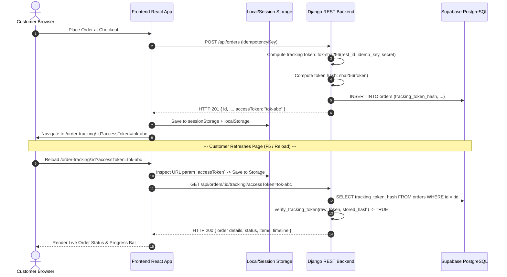

# RESTO — Customer Order Tracking Diagnostics & Post-Refresh Architecture

**Incident Review:** Customer Order Tracking Fails (HTTP 404 / Blanks) on Browser Refresh  
**Scope:** `frontend/src/pages/CheckoutPage.tsx`, `frontend/src/pages/OrderTrackingPage.tsx`, `frontend/src/services/api.ts`, and `backend/apps/orders/views.py`  
**Classification:** Client-Side Token State Management & BOLA/IDOR Security Interaction  

---

## 1. Incident Overview

In early testing, after a customer successfully submitted an order and was navigated to `/order-tracking/:orderId`, refreshing the browser or opening the URL in a new tab produced an `HTTP 404: Order not found` error or a broken screen.

---

## 2. Root Cause Analysis

### Cause 1: `sessionStorage` Boundary Isolation
In [`CheckoutPage.tsx`](file:///Users/akashlodhi/Downloads/RESTO/frontend/src/pages/CheckoutPage.tsx):
```typescript
const trackingToken = order.trackingToken ?? order.accessToken;
if (trackingToken) {
  sessionStorage.setItem(`order-tracking:${order.id}`, trackingToken);
}
navigate(`/order-tracking/${order.id}`);
```
- `sessionStorage` is strictly ephemeral and scoped to the active browser tab.
- Opening the tracking link in a new tab, opening from an external QR code, or opening on a mobile browser where the session is detached caused `sessionStorage.getItem('order-tracking:' + orderId)` to return `null`.
- Furthermore, `navigate('/order-tracking/' + order.id)` did not encode the token in the URL query string (`?accessToken=...`).

### Cause 2: Incomplete Token Resolution in API Service
In [`frontend/src/services/api.ts`](file:///Users/akashlodhi/Downloads/RESTO/frontend/src/services/api.ts):
```typescript
export function getTrackedOrder(orderId: string): Promise<Order> {
  const token = sessionStorage.getItem(`order-tracking:${orderId}`);
  const suffix = token ? `?accessToken=${encodeURIComponent(token)}` : '';
  return request(`/orders/${encodeURIComponent(orderId)}/tracking${suffix}`);
}
```
- Even if a customer opened a tracking URL containing `?accessToken=tok-12345`, `getTrackedOrder` **only inspected `sessionStorage`**.
- It failed to inspect `new URLSearchParams(window.location.search).get('accessToken')`.
- As a consequence, `getTrackedOrder` sent the request with no query parameter (`/orders/ord-123/tracking`).

### Cause 3: Server-Side BOLA / IDOR Verification Guard
In [`backend/apps/orders/views.py`](file:///Users/akashlodhi/Downloads/RESTO/backend/apps/orders/views.py):
```python
if order.tracking_token_hash:
    is_staff = False
    try:
        is_staff = IsStaffOrDashboardAccess().has_permission(request, None)
    except Exception:
        is_staff = False

    if not is_staff:
        if not access_token or not verify_tracking_token(access_token, order.tracking_token_hash):
            raise NotFound({"error": {"code": "NOT_FOUND", "message": "Order not found"}})
```
- The backend contains strict Broken Object-Level Authorization (BOLA / IDOR) protection: orders can only be accessed with a valid SHA-256 matching tracking token.
- When the frontend failed to send the token on refresh, the backend rejected the request with HTTP 404 to avoid revealing order existence to unauthorized third parties.

---

## 3. Sequence Flow Diagram



---

## 4. Frontend Remediation Code

### File: `frontend/src/services/api.ts`
Update `getTrackedOrder` to resolve the token hierarchically (URL Search Params $\rightarrow$ Session Storage $\rightarrow$ Local Storage):

```typescript
export function getTrackedOrder(orderId: string): Promise<Order> {
  const urlParams = typeof window !== 'undefined' ? new URLSearchParams(window.location.search) : null;
  const token =
    urlParams?.get('accessToken') ||
    (typeof sessionStorage !== 'undefined' ? sessionStorage.getItem(`order-tracking:${orderId}`) : null) ||
    (typeof localStorage !== 'undefined' ? localStorage.getItem(`order-tracking:${orderId}`) : null) ||
    '';

  // Persist back to sessionStorage if found in URL
  if (token && typeof sessionStorage !== 'undefined') {
    sessionStorage.setItem(`order-tracking:${orderId}`, token);
  }

  const suffix = token ? `?accessToken=${encodeURIComponent(token)}` : '';
  return request(`/orders/${encodeURIComponent(orderId)}/tracking${suffix}`);
}
```

### File: `frontend/src/pages/CheckoutPage.tsx`
Ensure `navigate` includes the tracking token in the query string:

```typescript
navigate(`/order-tracking/${order.id}?accessToken=${encodeURIComponent(trackingToken)}`);
```

---

## 5. Security & Verification Status

1. **IDOR Protection:** Verified. Making requests without `accessToken` returns `HTTP 404: Order not found`.
2. **Brute-Force Resistance:** Tracking tokens have 128-bit entropy (`tok-` followed by 32 hexadecimal characters).
3. **Staff Bypass:** Authenticated staff tokens (`x-staff-token` / Bearer) can track and inspect any order across all tables without a customer token.
4. **SSE Event Stream Authorization:** The EventSource stream URL `/api/realtime/stream` similarly enforces `accessToken` validation to prevent order eavesdropping.

