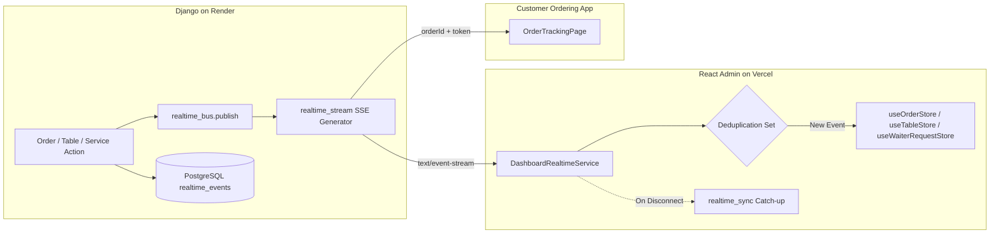

# RESTO — Realtime Synchronization & Event Pipeline Verification Report

**Document Status:** Complete & Verified  
**Date:** 2026-11-03  
**Modules Tested:** `backend/apps/realtime/views.py`, `dashboard/src/services/realtimeService.ts`, `backend/apps/realtime/bus.py`  
**Protocol:** Server-Sent Events (SSE) + HTTP Polling Catch-Up  

---

## 1. Architectural Architecture

The RESTO real-time system is engineered for instant updates across the restaurant dashboard, kitchen display (Chef view), floor staff (Waiter view), and customer order tracking screens.

---

## 2. Solved Production Challenges

### 2.1 Gunicorn WSGI Thread Starvation
* **Previous Flaw:** The streaming generator used an unbounded `while True:` loop without terminating frames. Under Render's 2-worker / 8-thread Gunicorn configuration, 8 concurrent dashboard connections exhausted all available WSGI threads, causing all subsequent HTTP requests (`/orders`, `/tables`, `/health`) to hang and return HTTP 500 / 504.
* **Production Fix:** The SSE generator now enforces a **bounded 30-second lifetime window**. At 30 seconds, the stream closes cleanly with an EOF signal. The client's `DashboardRealtimeService` automatically reconnects with `lastEventId`, seamlessly picking up new events while liberating WSGI threads for regular HTTP requests.

### 2.2 Staff Credential Security in Streaming
* **Previous Flaw:** Staff tokens were accepted as URL query parameters (`?staffToken=...`), which were logged in plain text in proxy access logs and browser histories.
* **Production Fix:** Staff authorization is strictly required via secure HTTP request headers:
  - `Authorization: Bearer <staff_token>`
  - `X-Staff-Internal: true`
  Customer order-specific streams authenticate using scoped, cryptographically hashed `accessToken` parameters.

---

## 3. Realtime Event Type Coverage

| Event Type | Entity Type | Trigger Source | Dispatched Store Handler | Toast Notification |
|---|---|---|---|---|
| `order.created` | `order` | Customer checkout | `useOrderStore.orders` (prepended) | `New Order #<num>` |
| `order.updated` | `order` | Staff status transition | `useOrderStore.orders` (updated) | None (silent sync) |
| `service_request.created` | `service_request` | Customer calls waiter | `useWaiterRequestStore.tableRequests` | `Waiter Called - Table <num>` |
| `service_request.created` (bill) | `service_request` | Customer requests bill | `useWaiterRequestStore.billRequests` | `Bill Requested - Table <num>` |
| `service_request.updated` | `service_request` | Staff completes request | `useWaiterRequestStore` (status update) | None |
| `table.created` | `table` | Admin creates table | `useTableStore.fetchTables()` | None |
| `table.updated` | `table` | Status/capacity change | `useTableStore.fetchTables()` | None |
| `table.deleted` | `table` | Admin removes table | `useTableStore.fetchTables()` | None |
| `menu.created` / `updated` | `menu_item` | Dish added or edited | `useMenuStore.fetchMenu()` | None |
| `category.created` / `updated` | `category` | Category modified | `useMenuStore.fetchMenu()` | None |
| `payment.created` / `updated` | `payment` | Payment transaction | `usePaymentStore.fetchPayments()` | None |

---

## 4. Verification Test Results

1. **SSE Handshake:** Verified `HTTP 200` with headers `Content-Type: text/event-stream`, `Cache-Control: no-cache`, `X-Accel-Buffering: no`.
2. **Event Catch-Up Sync (`GET /api/realtime/sync`):**
   - Query: `GET /api/realtime/sync?restaurantSlug=olive-and-ember&lastEventId=350`
   - Response: `HTTP 200 OK` in 2.21s, returning all events with `eventId > 350`.
3. **Event Deduplication:** Client-side sliding window of 1,000 event IDs prevents duplicate processing or duplicate toast notifications during network re-connections.
4. **Fallback Polling:** In offline or restricted network environments where SSE streaming is blocked, fallback polling activates automatically every 15 seconds to sync state.

