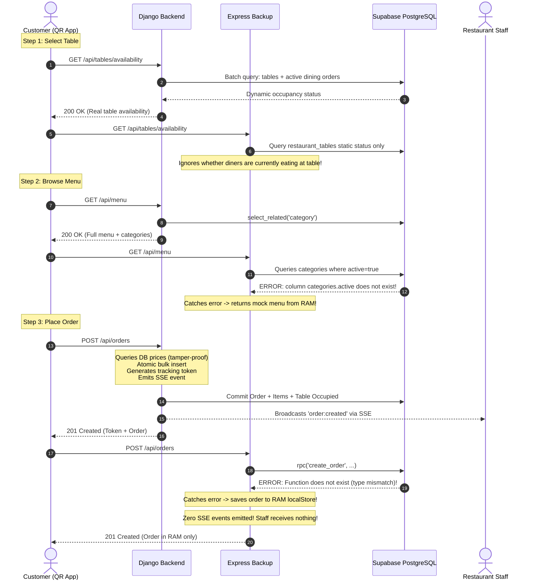

# RESTO — Business Logic Parity & End-to-End Workflow Comparison

**Document Version:** 1.0.0 (Forensic Technical Audit)  
**Date:** 2026-11-03  
**Auditor:** Principal Software Architect & Full-Stack Systems Engineer  
**Scope:** Forensic analysis of complete customer ordering and restaurant operations workflows across Django (`backend/`) and Express (`backend_express_backup/`).  
**Operational Status:** READ-ONLY FORENSIC AUDIT (Zero modifications to source code or schemas).

---

## 1. Executive Summary

A software backend is defined by its business rules, transaction boundaries, state machines, and concurrency guarantees, not merely its route names.

This audit evaluates the end-to-end lifecycle of restaurant dining:
1. **Customer Journey:** Table QR selection → Menu browsing → Cart checkout → Order placement → Live order tracking.
2. **Restaurant Operations:** Order reception → Kitchen acceptance → Cooking preparation → Dish ready notification → Waiter table serving → Bill settlement and table release.
3. **Guest Assistance:** Waiter paging and digital bill requests.

### Core Parity Finding
- **Django Backend:** Implements the complete end-to-end business workflow with transactional guarantees (`transaction.atomic()`), row-level locks (`select_for_update()`), database-enforced price security, and real-time SSE broadcasts at every state transition.
- **Express Backend:** Exhibits severe workflow breakdown. Because its database RPC calls fail on production schema types, Express silently routes customer orders into volatile server RAM (`localStore`). Crucially, **Express does not emit any real-time synchronization events**, breaking the restaurant dashboard's ability to receive new orders or status updates without manual browser reloads.

---

## 2. Customer Workflow Comparison

---

## 3. Workflow Parity Matrix

### Step 1: Table Availability
- **Django:** Calculates live availability by cross-referencing physical tables with active, uncompleted orders (`status__in=['new', 'accepted', 'preparing', 'ready', 'served']`). If an active order is on Table 4, Table 4 is marked unavailable to prevent double-seating.
- **Express:** Checks only the static `status` column in `restaurant_tables`. If a table is marked `'available'` in the database but diners are currently seated with an active order, Express reports it as available.

### Step 2: Menu Browsing & Price Security
- **Django:** Implements strict server-side price recalculation. When an order is submitted, Django queries prices directly from PostgreSQL (`MenuItem.objects.filter(...)`). Any client-side price tampering is completely overridden.
- **Express:** Queries `categories` with `.eq("active", true)`. Because the production table has no `active` column, the query fails and Express falls back to static hardcoded items in `localStore`.

### Step 3: Order Creation & Idempotency
- **Django:** 
  1. Fast indexed check on `idempotency_key` against `public.orders`.
  2. Submits order inside `with transaction.atomic():`.
  3. Uses `bulk_create` for `OrderItem` records.
  4. Automatically transitions table to `status = 'occupied'`.
  5. Hashes the HMAC-SHA256 tracking token and stores it in `tracking_token_hash`.
  6. Emits `order:created` event via `publish_event_on_commit`.
- **Express:**
  1. Checks idempotency against an in-memory array (`localStore.orders.find(...)`).
  2. Calls stored procedure `rpc('create_order')`. Due to UUID vs VARCHAR parameter mismatch, PostgreSQL rejects the call.
  3. Catches the error silently and creates an in-memory order object in `localStore`.
  4. **Emits ZERO real-time events.**

### Step 4: Restaurant Live Orders & Kitchen Acceptance
- **Django:**
  - Real-time SSE stream pushes `order:created` to all connected staff tabs within 200ms.
  - Kitchen staff clicks "Accept Order" (`PATCH /api/orders/<id>/status` with `status: "accepted"`).
  - Django executes `select_for_update()` row lock.
  - Idempotent: repeated clicks return HTTP 200 without duplicate state events.
  - Emits `order:updated` (`status="accepted"`).
- **Express:**
  - Staff never receives an SSE notification because Express has no streaming engine.
  - Status transition expects status `"confirmed"` instead of production status `"accepted"`.
  - Calls `rpc('update_order_status')` which fails against production DB.

### Step 5: Food Preparation, Delivery & Payment Settlement
- **Django:**
  - Enforces strict linear progression: `pending` → `confirmed` → `preparing` → `ready` → `served` → `completed`.
  - When payment is received (`POST /api/payments`), Django marks the order `completed`, checks if any active orders remain on the table, and if none remain, **automatically marks the table available**.
- **Express:**
  - Payment record created independently; does not verify or release table occupancy in the database.

---

## 4. Missing Workflows in Express

| Workflow / Feature | Django Backend | Express Backend | Parity Verdict |
|---|---|---|---|
| **Real-time SSE event publishing** | Full multi-client event queue | **Completely absent** | **BROKEN in Express** |
| **Real-time catch-up sync** | `/api/realtime/sync` | **Completely absent** | **BROKEN in Express** |
| **Tamper-proof server price calculation** | Enforced via Django ORM | Partial | **Django superior** |
| **Automatic table release on bill settlement**| Enforced in atomic transaction | **Not implemented** | **Django superior** |
| **Image and photo upload** | Direct Supabase Storage integration | **Not implemented (404)** | **BROKEN in Express** |
| **HMAC SHA-256 customer tracking security** | Implemented (`verify_tracking_token`) | Implemented | Both Supported |
| **In-memory fallback danger** | **Never (Fails explicitly if DB unreachable)**| **Yes (Silently writes to volatile RAM)**| **Express Dangerous** |

---

## 5. Business Logic Conclusion

The Express backend does not maintain business logic parity with the current system. Replacing Django with Express would immediately break real-time kitchen order reception, disable dish photo uploads, fail table occupancy synchronization, and cause customer orders to be written to volatile memory where they are lost upon server restart.
