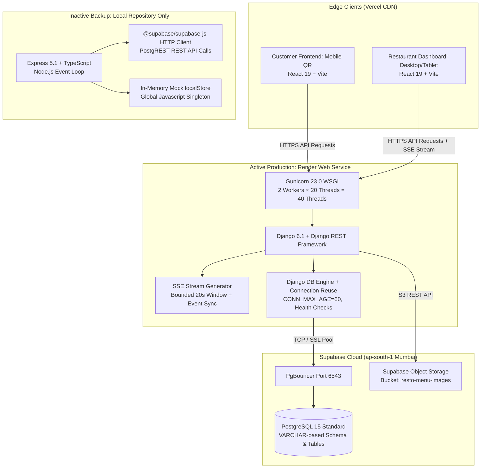

# RESTO — Complete Architecture & Dual-Backend Discovery Audit

**Document Version:** 1.0.0 (Forensic Technical Audit)  
**Date:** 2026-11-03  
**Auditor:** Principal Software Architect, Senior Django Engineer, Senior Node.js/Express Architect & Production SRE  
**Audit Scope:** Full repository discovery, infrastructure topology, and side-by-side architecture comparison of Django (`backend/`) and Express (`backend_express_backup/`).  
**Operational Status:** READ-ONLY FORENSIC AUDIT (Zero modifications to source code or schemas).

---

## 1. Executive Summary & Discovery Findings

The RESTO repository contains a modern restaurant management and QR-table ordering platform. An inspection of the codebase confirms that **two separate backend implementations coexist within the repository**:

1. **Active & Deployed Backend:** `backend/` — Built on Python 3.12 / Django 6.1 / Django REST Framework. Deployed as a web service on Render (`resto-vc53.onrender.com`), connecting directly to Supabase PostgreSQL 15 (`aws-0-ap-south-1.pooler.supabase.com:6543`) via direct TCP connection pooling (`psycopg2` / `pgbouncer`).
2. **Older Inactive Backup Backend:** `backend_express_backup/` — Built on Node.js / Express 5.1 / TypeScript. It is **not deployed to any hosting environment**, is absent from `render.yaml` and `Procfile`, and communicates with Supabase exclusively via `@supabase/supabase-js` HTTP PostgREST API client.

### Project Layout Map

```text
RESTO/
├── frontend/                     # Customer-facing React 19 / Vite SPA (Vercel)
├── dashboard/                    # Restaurant staff & manager React 19 / Vite SPA (Vercel)
├── backend/                      # [ACTIVE] Django 6.1 + DRF production backend (Render)
│   ├── apps/
│   │   ├── restaurants/          # Multi-tenant restaurant entity & settings
│   │   ├── tables/               # Floor management & table QR availability
│   │   ├── menu/                 # Categories, menu items & Supabase Storage upload
│   │   ├── orders/               # Customer ordering & staff order state machine
│   │   ├── payments/             # Cash & UPI payment processing & reconciliation
│   │   ├── service_requests/     # Waiter calls & bill assistance
│   │   ├── dashboard/            # Staff management & overview metrics
│   │   └── realtime/             # SSE event streaming generator & catchup sync
│   ├── config/                   # WSGI, URLs, connection pooling & Supabase client
│   └── supabase/                 # Production PostgreSQL migrations & RLS policies
├── backend_express_backup/       # [INACTIVE BACKUP] Node.js + Express 5 + TypeScript
│   ├── src/
│   │   ├── config/               # Environment parsing & Supabase JS client
│   │   ├── middleware/           # Auth, validation, errors, async handler
│   │   ├── lib/                  # Orders, restaurant scope, in-memory local-store
│   │   ├── routes/               # Single monolithic route file: public.ts
│   │   ├── app.ts                # Express application setup, Helmet, CORS, rate limits
│   │   └── server.ts             # HTTP server listener
│   └── supabase/                 # Legacy SQL migration (UUID-based schema)
├── render.yaml                   # Infrastructure-as-code for Render deployment (points to backend/)
├── Procfile                      # Process declaration: gunicorn 40 threads (backend/config/wsgi)
└── vercel.json                   # Edge routing for frontend & dashboard
```

---

## 2. Infrastructure & Deployment Topology



---

## 3. Architecture of Implementation 1: Django Backend (`backend/`)

### 3.1 Core Architecture & Framework
- **Framework:** Django 6.1 with Django REST Framework (DRF) 3.16.
- **Process Model:** Multi-threaded WSGI using Gunicorn with `gthread` worker class (`--threads 20 --workers 2`), offering a 40-concurrent-thread pool.
- **Database Access:** Direct native PostgreSQL connection via `psycopg2-binary`. Bypasses PostgREST HTTP abstraction. Queries run through Django ORM with SQL compilation, parameterized queries, and transactional integrity.
- **Connection Optimization:** Configured via [`backend/config/db_utils.py`](file:///Users/akashlodhi/Downloads/RESTO/backend/config/db_utils.py) with `CONN_MAX_AGE=60` and `CONN_HEALTH_CHECKS=True` to eliminate repetitive TLS handshakes against Supabase's transaction pooler on port 6543.
- **Real-Time Engine:** Built-in Server-Sent Events (SSE) streaming engine in [`backend/apps/realtime/views.py`](file:///Users/akashlodhi/Downloads/RESTO/backend/apps/realtime/views.py). Features a bounded 20-second thread release window, periodic keep-alive comments (`: keep-alive\n\n`), thread-safe multi-client event queue dispatcher, and a persistent PostgreSQL event log table (`public.realtime_events`) accessed via `/api/realtime/sync`.
- **Modularity:** 8 segregated Django apps (`restaurants`, `tables`, `menu`, `orders`, `payments`, `service_requests`, `dashboard`, `realtime`), each containing dedicated models, views, and serializers.

---

## 4. Architecture of Implementation 2: Express Backend (`backend_express_backup/`)

### 4.1 Core Architecture & Framework
- **Framework:** Express 5.1 running on Node.js (v20+ engine declaration) with TypeScript 5.9.
- **Process Model:** Single-threaded asynchronous event loop.
- **Database Access:** Indirect HTTP-based database access using `@supabase/supabase-js` v2.57.4. It does **not** maintain a direct PostgreSQL TCP socket connection or connection pool (no `pg` or `pg-pool` dependencies). Every query translates into an outbound HTTPS request to Supabase's PostgREST gateway.
- **Monolithic Structure:** Almost all business logic (restaurants, menu, tables, orders, payments, staff, service requests, dashboard analytics) is concentrated into a **single 919-line file** ([`backend_express_backup/src/routes/public.ts`](file:///Users/akashlodhi/Downloads/RESTO/backend_express_backup/src/routes/public.ts)).
- **In-Memory Fallback Singleton:** When Supabase is unreachable or returns an error, Express silently routes queries and mutations to [`backend_express_backup/src/lib/local-store.ts`](file:///Users/akashlodhi/Downloads/RESTO/backend_express_backup/src/lib/local-store.ts), an in-memory JavaScript class with hardcoded mock records.
- **Real-Time Engine:** **Completely Absent.** There is no SSE streaming endpoint, no WebSocket server, and no realtime event publishing in the Express code.

---

## 5. Architectural Comparison Matrix

| Dimension | Django Backend (`backend/`) | Express Backup (`backend_express_backup/`) |
|---|---|---|
| **Deployment Status** | **Active & Live** on Render (`resto-vc53.onrender.com`) | **Inactive / Undeployed** (Backup only) |
| **Language & Runtime** | Python 3.12 / Django 6.1 | TypeScript 5.9 / Node.js 20+ |
| **Database Connection** | Direct TCP / SSL via `psycopg2` & PgBouncer | HTTP REST calls via `@supabase/supabase-js` |
| **PostgreSQL Pooler** | Native connection reuse (`CONN_MAX_AGE=60`) | Relies entirely on Supabase PostgREST layer |
| **Realtime Updates** | SSE Stream (`/realtime/stream`) + Sync (`/realtime/sync`) | **None** (Endpoints do not exist; 404) |
| **Object Storage** | Native Supabase Storage multipart client (`/api/upload`) | **None** (No upload endpoint implemented) |
| **Modularity** | High (8 domain apps, isolated models & serializers) | Low (Monolithic 919-line `public.ts` router) |
| **Data Durability** | Strict: All writes go to Supabase PostgreSQL or fail | Risky: Catches errors and writes to volatile `localStore` |
| **Database Schema** | Aligned with production `01_schema.sql` (VARCHAR keys) | Aligned with legacy `initial_schema.sql` (UUID keys) |
| **Test Coverage** | 129 automated tests (E2E, Lifecycle, Security, Regression) | **0 tests** (No test files exist in the project) |
| **Build Integrity** | Clean Python environment; all tests pass | Corrupted `node_modules` (Missing `tsc.js` binary) |

---

## 6. Discovery Conclusion

The Django backend represents a complete, actively deployed, multi-tenant restaurant engine that directly integrates with the production Supabase PostgreSQL schema. The Express backend backup is an incomplete, monolithic prototype that lacks real-time streaming, image upload facilities, test coverage, and PostgreSQL schema compatibility.

