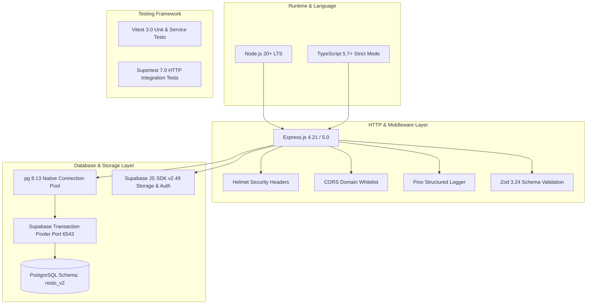
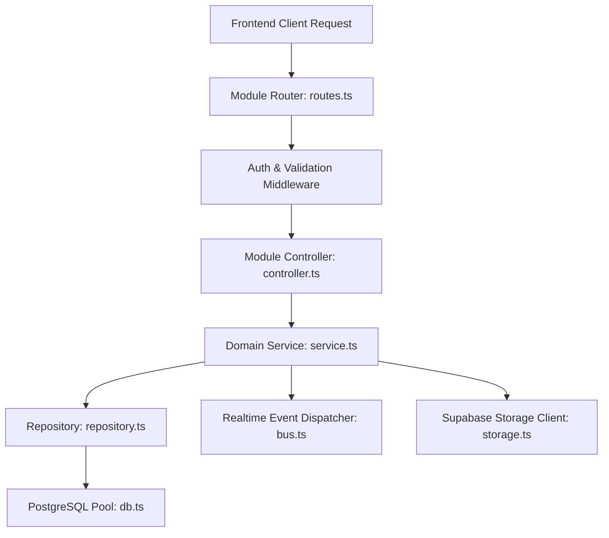

# RESTO V2 — Node.js & TypeScript Backend Architecture Specification

**Document Version:** 1.0.0 (Phase 2 Architectural Design)  
**Date:** 2026-11-03  
**Auditor / Architect:** Principal Node.js Architect & Distributed Systems Engineer  
**Target Module:** `backend_node/` (Node.js LTS / TypeScript Strict / Express / Supabase V2)  
**Target Schema:** `resto_v2` (Isolated PostgreSQL Schema)  
**Status:** PHASE 2 APPROVED ARCHITECTURE DESIGN

---

## 1. Executive Architecture Summary

RESTO V2 replaces the legacy prototype and Django backends with a **high-throughput, modular, strongly-typed Node.js LTS and TypeScript architecture**.

### Core Architecture Pillars:
1. **Isolated Schema (`resto_v2`):** Direct PostgreSQL operations target `search_path=resto_v2`. The existing `public` schema remains untouched.
2. **Direct Connection Pooling (`pg.Pool`):** Rather than relying on HTTP PostgREST abstraction, V2 maintains persistent TCP socket pools directly to Supabase PgBouncer (port 6543) with explicit connection reuse, bounded connection timeouts, and transaction support.
3. **Layered Clean Architecture:** Separation of concerns across Routes, Controllers, Services, Repositories, and Validators.
4. **Resilient Real-Time Pipeline:** Persistent SSE stream rotation, in-memory event dispatch, and database-backed audit cursors.
5. **Strict API Compatibility:** 100% adherence to the existing 45-endpoint frontend contract.

---

## 2. Technology Stack & Selected Dependencies



| Component | Technology | Rationale |
|---|---|---|
| **Runtime** | Node.js 20+ LTS | High-performance asynchronous non-blocking event loop; superior SSE scalability. |
| **Language** | TypeScript Strict | Full compile-time type safety; prevents undefined property errors and null pointer exceptions. |
| **Web Framework**| Express.js | Industry standard, lightweight, highly extensible HTTP routing engine. |
| **Database Pool**| `pg` (`node-postgres`)| Native TCP connection pooling; provides explicit `client.query('BEGIN')` transaction control. |
| **Validation** | Zod | Runtime schema validation with automatic TypeScript type inference. |
| **Logging** | Pino & Pino-HTTP | Ultra-fast JSON structured logging with request correlation IDs and zero overhead. |
| **Security** | Helmet & bcryptjs | Robust HTTP security headers, CSP, and secure password hashing. |
| **Storage** | Supabase Storage SDK| S3-compatible asset management for menu dish photos and restaurant logos. |

---

## 3. Layered Modular Architecture

To prevent the monolithic 900-line router problem identified in the older Express backup, `backend_node` enforces a strict 4-layer architecture within each domain module:



### Layer Responsibilities:
1. **Module Router (`modules/*/routes.ts`):** Defines HTTP paths and attaches authentication and Zod request validation middleware.
2. **Controller (`modules/*/controller.ts`):** Parses HTTP request parameters, invokes the domain service, and formats JSON responses with appropriate HTTP status codes.
3. **Service (`modules/*/service.ts`):** Contains business logic, pricing computations, tax calculations (5% GST), order state machine transitions, and transaction orchestration.
4. **Repository (`modules/*/repository.ts`):** Executes parameterized SQL queries directly against the `resto_v2` PostgreSQL schema.

---

## 4. Database Connection & Transaction Management

### 4.1 Native `pg.Pool` Configuration
[`backend_node/src/database/pool.ts`](file:///Users/akashlodhi/Downloads/RESTO/backend_node/src/database/):
```typescript
import pg from 'pg';
import { env } from '../config/env.js';

export const pool = new pg.Pool({
  connectionString: env.DATABASE_URL,
  ssl: { rejectUnauthorized: false },
  min: env.DB_POOL_MIN || 2,
  max: env.DB_POOL_MAX || 20,
  idleTimeoutMillis: env.DB_IDLE_TIMEOUT_MS || 30000,
  connectionTimeoutMillis: env.DB_CONNECTION_TIMEOUT_MS || 10000,
});
```

### 4.2 Explicit Transaction Helper
All multi-entity mutations (order placement, payment settlement, table release) use a reusable transaction wrapper:
```typescript
export async function withTransaction<T>(
  callback: (client: pg.PoolClient) => Promise<T>
): Promise<T> {
  const client = await pool.connect();
  try {
    await client.query('BEGIN');
    const result = await callback(client);
    await client.query('COMMIT');
    return result;
  } catch (error) {
    await client.query('ROLLBACK');
    throw error;
  } finally {
    client.release();
  }
}
```

---

## 5. Centralized Error Handling & Logging

### 5.1 Custom Application Error Hierarchy
All business errors inherit from `AppError`:
```typescript
export class AppError extends Error {
  constructor(
    public readonly statusCode: number,
    public readonly message: string,
    public readonly code: string = 'INTERNAL_ERROR',
    public readonly details: any = null
  ) {
    super(message);
    Object.setPrototypeOf(this, new.target.prototype);
  }
}
```

### 5.2 Global Error Handler Middleware
- Catches unhandled rejections, Zod validation errors, and PostgreSQL constraint violations.
- Sanitizes internal database errors and never leaks database connection strings or passwords.
- Always returns standardized JSON:
  ```json
  {
    "error": {
      "code": "VALIDATION_ERROR",
      "message": "Item quantity must be between 1 and 50"
    }
  }
  ```

---

## 6. Server Lifecycle & Graceful Shutdown

[`backend_node/src/server.ts`](file:///Users/akashlodhi/Downloads/RESTO/backend_node/src/server.ts):
- Handles `SIGTERM` and `SIGINT` signals gracefully.
- Rejects new incoming HTTP connections while allowing in-flight requests and active SSE chunk windows to finish cleanly within a 10-second timeout.
- Closes the PostgreSQL connection pool (`pool.end()`).
