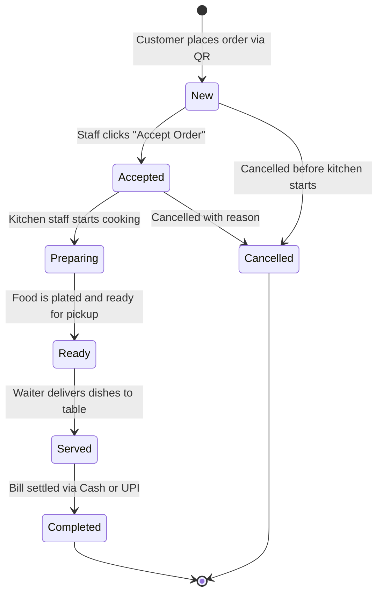

# RESTO V2 — Existing System Forensic Audit & Technical Specifications

**Document Version:** 1.0.0 (Phase 1 Baseline Discovery)  
**Date:** 2026-11-03  
**Auditor:** Principal Node.js Architect, TypeScript Engineer & Supabase Specialist  
**Target Systems:**
- Customer Frontend: React 19 + Vite 8 ([`frontend/`](file:///Users/akashlodhi/Downloads/RESTO/frontend/))
- Restaurant Management Dashboard: React 19 + Vite 8 ([`dashboard/`](file:///Users/akashlodhi/Downloads/RESTO/dashboard/))
- Current Active Backend: Django 6.1 DRF ([`backend/`](file:///Users/akashlodhi/Downloads/RESTO/backend/))
- Permanent Production Database: Supabase PostgreSQL 15 (`aws-0-ap-south-1.pooler.supabase.com:6543`, Mumbai)  
**Status:** PHASE 1 DISCOVERY COMPLETE

---

## 1. Executive Summary

This audit establishes the comprehensive technical specification and functional inventory required to rebuild RESTO's backend from scratch using a modern **Node.js LTS, TypeScript, and Supabase V2 architecture (`backend_node/`)**.

### Critical Migration Rule:
- **Zero Frontend Redesign:** The existing React applications (`frontend/` and `dashboard/`) must remain **100% untouched in business UI, layout, and UX flows**. 
- The new Node.js backend must satisfy every existing HTTP route, request payload, response schema, authentication contract, and real-time event shape.

---

## 2. Customer Frontend Structure (`frontend/`)

### 2.1 Technology Stack & Organization
- **Framework:** React 19 with Vite 8 (TypeScript).
- **Styling:** Tailwind CSS with Lucide React icons.
- **State Management:** Custom reactive stores and browser storage (`sessionStorage` & `localStorage`).
- **Target Experience:** Mobile-first responsive web app accessed by scanning physical table QR codes (`/menu?table=04`).

### 2.2 Component Hierarchy & User Flow
```text
frontend/src/
├── main.tsx                      # Root mount point
├── App.tsx                       # React Router configuration & global providers
├── pages/
│   ├── TableSelectionPage.tsx    # Customer selects/confirms their table
│   ├── MenuPage.tsx              # Category tabs, search, dietary filter (Veg/Non-Veg), dish cards
│   ├── ItemDetailPage.tsx        # Dish modal: quantity, addons, special instructions
│   ├── CartPage.tsx              # Review items, breakdown (Subtotal, 5% GST, Total), checkout
│   ├── OrderTrackingPage.tsx     # Real-time SSE status progression, ETA, order details
│   └── ServiceRequestModal.tsx   # "Call Waiter" / "Request Bill" modal
├── services/
│   ├── api.ts                    # HTTP client (fetch, deduplication, timeout handling)
│   └── realtime.ts               # SSE stream consumer for live order updates
└── context/                      # Cart context & table context providers
```

### 2.3 Customer Ordering Journey (11 Key Steps)
1. **Restaurant Branding Load:** Fetches `/api/restaurants/info?slug=olive-and-ember`.
2. **Table Availability:** Fetches `/api/tables/availability?restaurantSlug=olive-and-ember`.
3. **Menu Catalog:** Fetches `/api/menu?restaurantSlug=olive-and-ember` (returns categories and items).
4. **Category Filtering:** Filter by Category (`cat-starters`, `cat-mains`, etc.) or dietary toggle (`veg` vs `all`).
5. **Item Customization:** Select addons (e.g. "Sharing Plate", "Extra Cheese") and special notes ("Less oil").
6. **Cart Management:** Dynamic calculation of subtotal, 2.5% CGST, 2.5% SGST (5% total GST), and final total.
7. **Checkout Submission:** `POST /api/orders` with idempotency key, items, table number, and payment method (`counter` or `upi`).
8. **Token Acquisition:** Server returns HTTP 201 with `accessToken` (HMAC tracking token).
9. **Order Tracking:** Stored in `sessionStorage['order-tracking:<id>']`; navigates to `/order-tracking/<id>`.
10. **Real-time SSE Stream:** Listens on `/api/realtime/stream?restaurantSlug=olive-and-ember&targetOrderId=<id>`.
11. **Service Requests:** Dispatches `/api/service-requests` for waiter assistance or digital bill.

---

## 3. Restaurant Dashboard Structure (`dashboard/`)

### 3.1 Technology Stack & Organization
- **Framework:** React 19 with Vite 8 (TypeScript).
- **State Management:** Zustand stores (`useOrderStore`, `useTableStore`, `usePaymentStore`, `useWaiterRequestStore`, `useBackendStatusStore`, `useDashboardDataStore`).
- **Real-Time Integration:** `dashboardRealtimeService` connecting to SSE `/api/realtime/stream` with continuous 20-second chunk auto-reconnect and `/api/realtime/sync` catch-up.

### 3.2 Component Hierarchy & Views
```text
dashboard/src/
├── main.tsx                      # Root mount point
├── App.tsx                       # Dashboard layout, navigation bar, connection status banner
├── components/
│   ├── Header.tsx                # Status indicator ("Connected", "Server Waking Up", "Unavailable")
│   ├── LiveOrders.tsx            # Real-time order kanban: New -> Accepted -> Preparing -> Ready -> Served
│   ├── TablesFloor.tsx           # Visual floor layout, occupancy indicators, QR download, add table
│   ├── MenuManagement.tsx        # Menu catalog editor, dish modal, image upload, out-of-stock toggle
│   ├── CategoriesManager.tsx     # Category creation, reordering, visibility toggle
│   ├── PaymentsView.tsx          # Financial transaction logs, settlement status, UPI references
│   ├── ServiceRequestsView.tsx   # Live waiter paging and bill assistance cards
│   ├── OverviewAnalytics.tsx     # Today's revenue, order counts, active tables, average order value
│   ├── DailySalesChart.tsx       # 14-day historical sales bar/line chart
│   └── RestaurantSettings.tsx    # WiFi SSID, tax rate, service charge, opening hours
├── services/
│   ├── api.ts                    # Dashboard API service with SWR caching and retry logic
│   └── realtimeService.ts        # SSE stream listener, sliding-window event deduplication
└── store/                        # Zustand global stores
```

---

## 4. Master API Endpoint Inventory (45 Endpoints)

Every endpoint below is actively invoked by the frontends and must be implemented in `backend_node/`:

| # | Method | Path | Client Caller | Purpose | Auth Requirement |
|---|---|---|---|---|---|
| 1 | `GET` | `/api/health/live` | Dashboard status monitor | Liveness check (< 5ms in-memory probe) | Public |
| 2 | `GET` | `/api/health/ready` | Dashboard readiness check | Readiness probe (`SELECT 1;` DB ping) | Public |
| 3 | `GET` | `/api/health` | Diagnostics | Overall health status + storage status | Public |
| 4 | `GET` | `/api/restaurants/info` | Customer Header | Restaurant details by `slug` parameter | Public |
| 5 | `GET` | `/api/restaurants/:slug` | Customer App | Restaurant details by route parameter | Public |
| 6 | `GET` | `/api/staff/restaurant-settings` | Dashboard Settings | Full operational settings for staff | Staff Bearer Token |
| 7 | `PUT` | `/api/restaurants/settings` | Dashboard Settings | Update tax, service charge, WiFi, hours | Staff Bearer Token |
| 8 | `GET` | `/api/tables/availability` | Customer QR App | Dynamic table occupancy and availability | Public |
| 9 | `GET` | `/api/tables` | Dashboard Floor | Full floor table list with active orders | Staff Bearer Token |
| 10 | `POST` | `/api/tables` | Dashboard Floor | Create new dining table | Staff Bearer Token |
| 11 | `PUT` | `/api/tables/:id` | Dashboard Floor | Update table capacity, zone, number | Staff Bearer Token |
| 12 | `PATCH` | `/api/tables/:id/status` | Dashboard Floor | Manually toggle table status | Staff Bearer Token |
| 13 | `DELETE` | `/api/tables/:id` | Dashboard Floor | Delete dining table (if no active orders)| Staff Bearer Token |
| 14 | `GET` | `/api/menu` | Customer Menu | Full menu items & categories | Public |
| 15 | `GET` | `/api/menu/categories` | Customer Tabs | Category list | Public |
| 16 | `GET` | `/api/staff/menu` | Dashboard Menu | Full menu management view | Staff Bearer Token |
| 17 | `POST` | `/api/staff/menu` | Dashboard Menu | Create new dish | Staff Bearer Token |
| 18 | `PATCH` | `/api/menu/:id` | Dashboard Menu | Update dish details | Staff Bearer Token |
| 19 | `PATCH` | `/api/menu/:id/availability` | Dashboard Quick Toggle | Toggle 86 / out-of-stock status | Staff Bearer Token |
| 20 | `DELETE` | `/api/menu/:id` | Dashboard Menu | Delete menu item | Staff Bearer Token |
| 21 | `POST` | `/api/upload` | Dashboard Menu/Settings | Upload dish photo to Supabase Storage | Staff Bearer Token |
| 22 | `POST` | `/api/categories` | Dashboard Categories | Create new category | Staff Bearer Token |
| 23 | `PUT` | `/api/categories/:id` | Dashboard Categories | Update category name, order, visibility | Staff Bearer Token |
| 24 | `DELETE` | `/api/categories/:id` | Dashboard Categories | Delete category | Staff Bearer Token |
| 25 | `POST` | `/api/orders` | Customer QR Checkout | Atomic order placement | Public (Idempotency Key) |
| 26 | `GET` | `/api/orders` | Dashboard Live Orders | Paginated orders feed with item prefetch | Staff Bearer Token |
| 27 | `GET` | `/api/orders/:id` | Staff Order View | Order detail by ID | Staff Bearer Token |
| 28 | `GET` | `/api/orders/:id/tracking` | Customer Tracking | Live order tracking with breakdown | HMAC Tracking Token |
| 29 | `PATCH` | `/api/orders/:id/status` | Staff Order Actions | Status machine: Accept, Prep, Ready, Serve | Staff Bearer Token |
| 30 | `POST` | `/api/service-requests` | Customer Assistance | Call waiter or request bill | Public |
| 31 | `GET` | `/api/service-requests` | Dashboard Waiter View | List active assistance requests | Staff Bearer Token |
| 32 | `PATCH` | `/api/service-requests/:id` | Dashboard Waiter View | Mark request in-progress or completed | Staff Bearer Token |
| 33 | `GET` | `/api/dashboard/overview` | Dashboard Home | Key metrics: Revenue, orders, active tables | Staff Bearer Token |
| 34 | `GET` | `/api/dashboard/recent-orders` | Dashboard Home | Top 10 recent orders | Staff Bearer Token |
| 35 | `GET` | `/api/dashboard/daily-sales` | Dashboard Analytics | 14-day aggregated daily revenue | Staff Bearer Token |
| 36 | `GET` | `/api/payments` | Dashboard Payments | List all transaction records | Staff Bearer Token |
| 37 | `POST` | `/api/payments` | Dashboard Settle Bill | Record payment & auto-release table | Staff Bearer Token |
| 38 | `PATCH` | `/api/payments/:id/status` | Dashboard Settle Bill | Update status (completed / refunded) | Staff Bearer Token |
| 39 | `GET` | `/api/staff` | Dashboard Staff Settings | List restaurant team members | Staff Bearer Token |
| 40 | `POST` | `/api/staff` | Dashboard Staff Settings | Invite new staff member | Staff Bearer Token |
| 41 | `PATCH` | `/api/staff/:id/status` | Dashboard Staff Settings | Activate/deactivate staff account | Staff Bearer Token |
| 42 | `POST` | `/api/auth/login` | Staff Login View | Staff login credentials check | Public |
| 43 | `GET` | `/api/auth/me` | Dashboard Session | Current authenticated staff profile | Staff Bearer Token |
| 44 | `GET` | `/api/realtime/stream` | **Customer & Dashboard** | **Continuous SSE Event Stream** | **Public or Staff** |
| 45 | `GET` | `/api/realtime/sync` | **Dashboard Recovery** | **Historical Catch-Up Event Replay** | **Staff Bearer Token** |

---

## 5. Business Logic & Calculation Specifications

### 5.1 Pricing, Tax & Financial Calculations
- **Base Subtotal:** Sum of all item line totals: `unitPrice * quantity`.
- **Addons:** Addon prices are added to the unit price before line total multiplication: `(item.price + sum(addons.price)) * quantity`.
- **Tax (5% GST):**
  - **CGST:** `subtotal * 0.025` (Rounded to 2 decimal places).
  - **SGST:** `subtotal * 0.025` (Rounded to 2 decimal places).
  - **Total GST:** `CGST + SGST` (Strictly 5.00%).
- **Service Charge:** Calculated from `restaurant.service_charge_percentage` (default 0.00% or 5.00%).
- **Final Total:** `subtotal + gst_total + service_charge`.
- **Security Rule:** All prices MUST be looked up directly from the database; prices passed from frontend payloads MUST be completely ignored to prevent client-side price tampering.

### 5.2 Order State Machine Progression


### 5.3 Table Occupancy & Auto-Release Rules
- **Occupied Condition:** A table is marked `'occupied'` as soon as an order is created (`POST /api/orders`).
- **Auto-Release Condition:** When a payment is recorded (`POST /api/payments`), the backend checks if any uncompleted orders remain on that table. If all orders on that table are `'completed'` or `'cancelled'`, the backend **automatically transitions the table to `'available'`**.

---

## 6. Authentication & Security Architecture

1. **Staff Token Security:**
   - Transported via `Authorization: Bearer <token>` or `X-Staff-Token: <token>`.
   - Validated server-side against `public.staff` table.
2. **Customer Tracking Token (HMAC SHA-256):**
   - Generated upon order placement using server secret `TRACKING_TOKEN_SECRET`:
     `digest = SHA256(restaurant_id + ":" + idempotency_key + ":" + secret)`
   - Hash stored in `public.orders.tracking_token_hash`.
   - Customer tracking requests must provide `?accessToken=<token>` matching the stored hash. This completely eliminates BOLA/IDOR vulnerabilities.
3. **Multi-Tenant Isolation:**
   - Every single database query must include `restaurant_id = <resolved_id>`.
   - All tenant slugs default to `'olive-and-ember'`.

