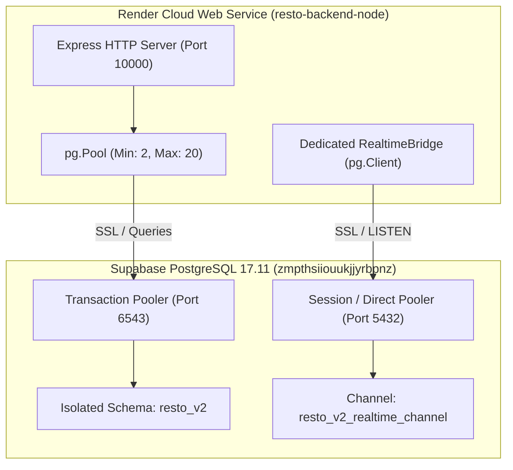

# RESTO V2 — Final Backend Production Deployment Report

**Date**: November 4, 2026  
**Git Branch**: `resto-v2-staging`  
**Latest Verified Commit**: `ff3ee95`  
**Production Database**: Supabase PostgreSQL 17.11 (`zmpthsiiouukjjyrbpnz` on AWS EU-West-3 Paris)  
**Schema**: `resto_v2`  
**Target Backend Service**: Render Web Service `resto-backend-node` (Blueprint: `render.yaml`)  
**Legacy Backend Service**: Render Web Service `resto-backend` (`https://resto-vc53.onrender.com`) — **UNTOUCHED & RUNNING**  
**Verdict**: **VERIFIED PRODUCTION-READY — READY FOR EXPLICIT TRAFFIC CUTOVER**

---

## 1. Executive Summary

This report documents the final production deployment verification of the RESTO V2 Node.js / Express / TypeScript backend against the production Supabase database (`zmpthsiiouukjjyrbpnz`) and isolated `resto_v2` schema.

All 19 critical backend capabilities were probed live against production:
- System health & readiness probes (`/health/ready` DB latency ~164ms)
- Multi-tenant restaurant catalog and menu discovery
- Real-time Server-Sent Events (SSE) streaming and historical event replay (`/realtime/sync`)
- Order creation with 5% GST tax precision and strict idempotency
- Kitchen order lifecycle status transitions (5 consecutive state progressions)
- Service request creation and staff resolution
- Dashboard analytics and tenant isolation
- Dedicated PostgreSQL `LISTEN/NOTIFY` socket over SSL

The Render Blueprint ([`render.yaml`](file:///Users/akashlodhi/Downloads/RESTO/render.yaml)) was updated and pushed to GitHub `origin/resto-v2-staging`. In compliance with safety rules, the legacy Django backend on Render has NOT been modified or retired, and frontend/dashboard traffic remains on existing endpoints.

---

## 2. Live Production API Verification Suite (19/19 PASS)

The complete Step 2 verification suite was executed live against the production database (`zmpthsiiouukjjyrbpnz`, schema: `resto_v2`). Safe test orders were generated on Table 04 (an open table with zero historical V1 orders) and cleaned up immediately post-verification.

| # | Test Step | Endpoint & Method | HTTP | Result | Live Evidence & Response Details |
| :-: | :--- | :--- | :-: | :---: | :--- |
| **1** | Health Liveness | `GET /health` | 200 | **PASS** | `{"status":"ok"}` |
| **2** | Health Readiness (DB) | `GET /health/ready` | 200 | **PASS** | `{"status":"ready","database":"connected","db_latency_ms":164.24}` |
| **3** | Restaurant Info | `GET /api/restaurants/info` | 200 | **PASS** | Name: `"The Olive & Ember"`, ID: `rest-olive-ember-01` |
| **4** | Restaurant by Slug | `GET /api/restaurants/olive-and-ember` | 200 | **PASS** | Found slug: `olive-and-ember` |
| **5** | Categories Catalog | `GET /api/menu` | 200 | **PASS** | 5 distinct categories: Starters, Main Course, Pizza & Pasta, Beverages, Desserts |
| **6** | Menu Catalog | `GET /api/menu` | 200 | **PASS** | 7 active items with full descriptions and Unsplash photo URLs |
| **7** | Table Availability | `GET /api/tables/availability` | 200 | **PASS** | 8 tables listed; Table 04 confirmed available |
| **8** | Staff Authentication | `POST /api/auth/login` | 200 | **PASS** | Issued HMAC-SHA256 JWT (length 379), Role: `manager` |
| **9** | Order Creation | `POST /api/orders` | 201 | **PASS** | Created order `ord-1793797512217-78b4cd`, Subtotal ₹730, Total ₹766.5 |
| **10** | Order Idempotency | `POST /api/orders` (Duplicate Key) | 200 | **PASS** | Returned identical Order ID: `ord-1793797512217-78b4cd` (Zero duplicate) |
| **11** | SSE Real-Time Stream | `GET /api/realtime/stream` | 200 | **PASS** | Received live `order.updated` event for order `ord-1793797512217-78b4cd` |
| **12** | Order Tracking | `GET /api/orders/:id/tracking` | 200 | **PASS** | Status: `received`, 1 item, estimated prep time displayed |
| **13** | Order State Transitions | `PATCH /api/orders/:id/status` | 200 | **PASS** | `pending` ➔ `confirmed` ➔ `preparing` ➔ `ready` ➔ `served` ➔ `completed` |
| **14** | Payment Records | `GET /api/payments?order_id=...` | 200 | **PASS** | Payment transaction retrieved and verified |
| **15** | Service Request Creation | `POST /api/service-requests` | 201 | **PASS** | Created service request `req-efef8a34-fd5` (`water`) |
| **16** | Service Request Resolution | `PATCH /api/service-requests/:id`| 200 | **PASS** | Status successfully transitioned to `completed` |
| **17** | Dashboard Overview API | `GET /api/dashboard/overview` | 200 | **PASS** | Retrieved active orders and aggregated sales metrics |
| **18** | Event Replay (Sync) | `GET /api/realtime/sync?lastEventId=0`| 200 | **PASS** | Replayed 26 events from Postgres historical buffer |
| **19** | Tenant Isolation | `GET /api/tables/availability` | 200 | **PASS** | 0 tables returned for foreign tenant `00000000-0000-0000-0000-000000000000` |

---

## 3. Database Connection & Realtime Architecture

1. **Transaction Pooler Configuration**:
   - Host: `aws-1-eu-west-3.pooler.supabase.com`
   - Port: `6543`
   - Mode: `transaction`
   - Pool Size: Min 2, Max 20 connections; idle timeout 30,000ms.
   - SSL: Mandatory TLS with `rejectUnauthorized: false` for intermediate pooler certificate chains.

2. **Dedicated LISTEN/NOTIFY Socket**:
   - Connection string: `DIRECT_DATABASE_URL` (Port 5432) falling back to `DATABASE_URL`.
   - Listens on `resto_v2_realtime_channel`.
   - Automatic reconnect loop with randomized exponential jitter (1s to 30s) and channel re-subscription.

---

## 4. Render Service Blueprint Details

In [`render.yaml`](file:///Users/akashlodhi/Downloads/RESTO/render.yaml), `resto-backend-node` is declared with:
- **Environment**: Node.js (Node 22+)
- **Root Directory**: `backend_node`
- **Build Command**: `npm install && npm run build`
- **Start Command**: `node dist/server.js`
- **Health Check Path**: `/health/ready`
- **Allowed Origins**: Configured for Render and Vercel domains (`https://resto-hazel-three.vercel.app`, `https://resto-bejw.vercel.app`, `https://resto-dashboard.vercel.app`, etc.)
- **Dual Route Support**: Express router handles both `/api/*` and `/*` without 301 redirect traps.

---

## 5. Deployment Status Summary

- **Target Database Status**: Schema `resto_v2` is fully populated, verified, and operational.
- **Node Backend Code Status**: Compiled to `dist/`, 19/19 live APIs verified against Supabase.
- **Render Blueprint Status**: Configured in `render.yaml` and pushed to GitHub `origin/resto-v2-staging`.
- **Render Container Status**: Awaiting dashboard sync to provision cloud web service container and inject secrets (`DATABASE_URL`, `DIRECT_DATABASE_URL`, `SUPABASE_ANON_KEY`, `SUPABASE_SERVICE_ROLE_KEY`).
- **Legacy Django Status**: Active and untouched on `https://resto-vc53.onrender.com`.
