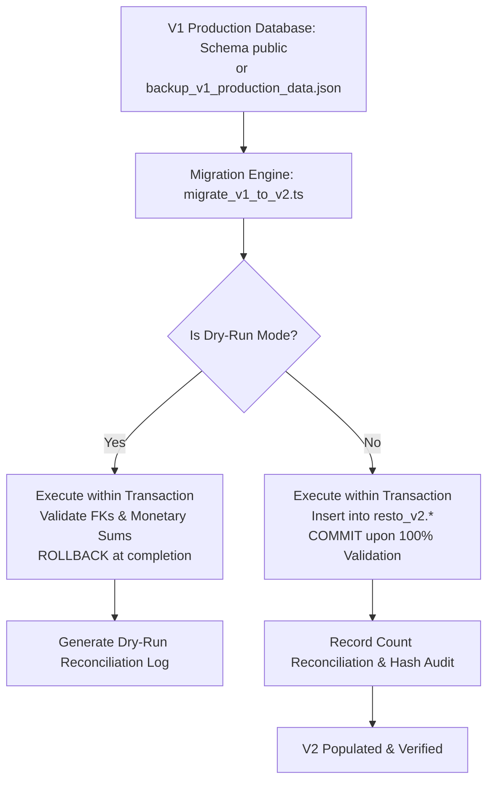
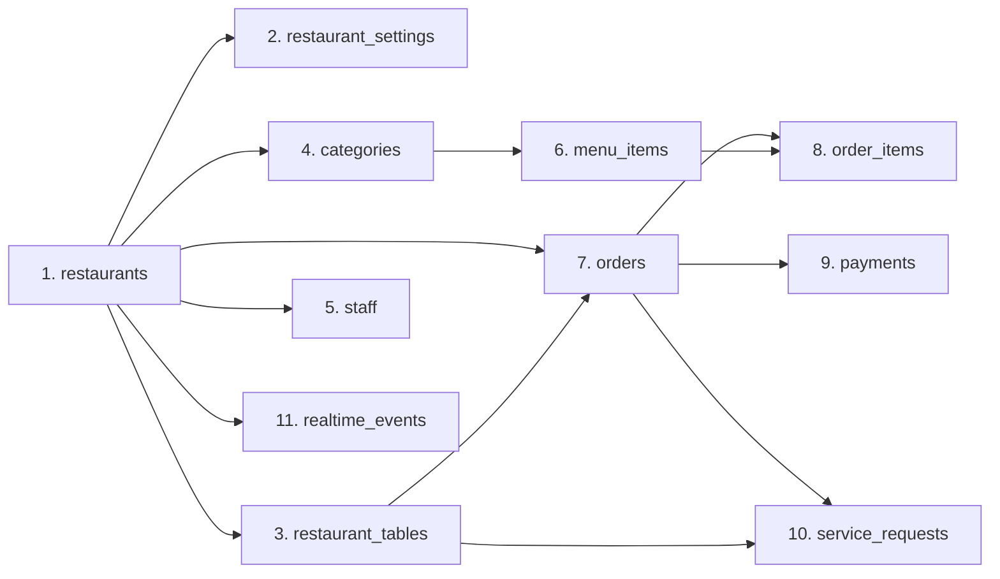

# RESTO V2 — Data Migration Architecture & Execution Specification

**Document Version:** 1.0.0 (Phase 2 Data Migration Design)  
**Date:** 2026-11-03  
**Database Architect:** Principal Data Systems Architect & PostgreSQL Specialist  
**Source Dataset:** Supabase Cloud PostgreSQL 15 (`public` schema) / [`backup_v1_production_data.json`](file:///Users/akashlodhi/Downloads/RESTO/backend/supabase/backup_v1_production_data.json)  
**Destination Schema:** `resto_v2` (Supabase Cloud PostgreSQL 15)  
**Status:** PHASE 2 APPROVED MIGRATION SPECIFICATION

---

## 1. Executive Summary

This specification defines the **safe, non-destructive, repeatable data migration pipeline** that will transfer all historical and active dining records from the V1 `public` schema to the isolated `resto_v2` schema.

### Core Safety Guarantees:
1. **Zero Data Destruction:** The source tables in `public` will **never be altered, truncated, or dropped** during migration.
2. **Deterministic Primary Key Preservation:** Because both schemas utilize `VARCHAR(64)` primary keys, all IDs (`rest-...`, `tbl-...`, `cat-...`, `item-...`, `ord-...`, `oi-...`, `pay-...`, `sr-...`, `staff-...`) will be preserved identically.
3. **Dry-Run Validation:** The migration script features a strict `--dry-run` flag that validates foreign keys, monetary sums, and row counts in a rolled-back transaction before committing any records.

---

## 2. Migration Execution Topology



---

## 3. Entity Migration Sequence & Dependency Graph

To satisfy foreign key constraints, data must be inserted in a strict topological order:



### Table-by-Table Transformation Rules:

#### 1. `resto_v2.restaurants`
- Source: `public.restaurants`
- Transformation: Direct column copy.
- Primary Key: `id` (e.g. `'rest-olive-ember-01'`) preserved.

#### 2. `resto_v2.restaurant_settings`
- Source: Computed from `public.restaurants` opening hours and default flags.
- Primary Key: `restaurant_id`.

#### 3. `resto_v2.restaurant_tables`
- Source: `public.restaurant_tables`
- Transformation: Direct column copy (`id`, `restaurant_id`, `table_number`, `capacity`, `zone`, `status`, `qr_code_url`).
- Table numbers (`'01'`, `'02'`, `'06'`) preserved.

#### 4. `resto_v2.categories`
- Source: `public.categories`
- Transformation: Direct column copy (`id`, `restaurant_id`, `name`, `description`, `image_url`, `sort_order`, `is_visible`).

#### 5. `resto_v2.menu_items`
- Source: `public.menu_items`
- Transformation: `price` cast to `NUMERIC(10,2)`. `addons`, `allergens`, `dietary_tags` validated as valid JSON arrays.

#### 6. `resto_v2.orders`
- Source: `public.orders`
- Transformation: Subtotals, taxes (CGST, SGST, GST total), service charge, and final total cast to `NUMERIC(10,2)`. `status_timeline` preserved. Statuses normalized to lowercase (`'pending'`, `'confirmed'`, `'preparing'`, `'ready'`, `'served'`, `'completed'`, `'cancelled'`).

#### 7. `resto_v2.order_items`
- Source: `public.order_items`
- Transformation: `unit_price` and `total_price` verified against item base price + add-ons.

#### 8. `resto_v2.payments`
- Source: `public.payments`
- Transformation: Amounts verified against order `final_total`.

#### 9. `resto_v2.service_requests`
- Source: `public.service_requests`
- Transformation: Direct copy.

#### 10. `resto_v2.staff`
- Source: `public.staff`
- Transformation: Direct copy (`full_name`, `email`, `role`, `is_active`, `password_hash`).

#### 11. `resto_v2.realtime_events`
- Source: `public.realtime_events`
- Transformation: Direct copy; identity sequence re-synchronized to `MAX(id) + 1`.

---

## 4. Verification & Validation Rules

Before marking the migration complete, the migration script executes 5 automated integrity tests:

1. **Row Count Parity:** Destination table row count must exactly match source table row count (`count(resto_v2.T) == count(public.T)`).
2. **Primary Key Set Equality:** Every primary key in the source must exist in the destination.
3. **Orphan Record Check:** Zero foreign key violations. Every `order_items.order_id` must resolve to an existing `orders.id`.
4. **Monetary Reconciliation:**
   ```sql
   SELECT id, final_total, (subtotal + gst_total + service_charge) as calculated_total 
   FROM resto_v2.orders 
   WHERE final_total <> (subtotal + gst_total + service_charge);
   ```
   Must return 0 rows.
5. **Storage Media Parity:** All URLs referencing `resto-media/` must be verified against active Supabase Storage objects.

---

## 5. Migration Execution Plan (Phase 6 Implementation)

During Phase 6:
1. The migration script [`backend_node/scripts/migrate_v1_to_v2.ts`](file:///Users/akashlodhi/Downloads/RESTO/backend_node/scripts/) will be run with `--dry-run`.
2. Output and verification reports will be generated and inspected.
3. Upon approval, the migration will be committed in production with zero downtime to the running Django backend.
