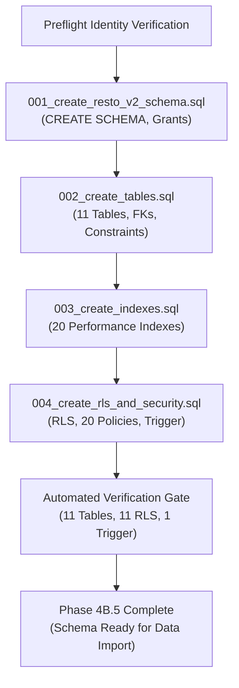

# RESTO V2 — Phase 4B.5 Migration Execution Plan

**Document Status**: REVIEWED & READY FOR EXPLICIT AUTHORIZATION  
**Execution State**: PENDING USER APPROVAL (DDL NOT YET EXECUTED)  
**Date**: November 4, 2026  
**Target Project Reference**: `zmpthsiiouukjjyrbpnz`  
**Target Host**: `https://zmpthsiiouukjjyrbpnz.supabase.co`  
**Target PostgreSQL Schema**: `resto_v2` (Dedicated & Isolated)  
**Git Branch**: `resto-v2-staging` (Commit `5092d60`)  

---

## 1. Objective & Boundaries

The purpose of Phase 4B.5 is to prepare and safely execute the creation of the isolated `resto_v2` PostgreSQL schema and its structural objects in the primary Supabase project (`zmpthsiiouukjjyrbpnz`).

### Scope Boundaries:
- **IN SCOPE**: Schema initialization, table definition, indexes, constraints, row-level security (RLS) policies, permissions, trigger function, and schema verification.
- **OUT OF SCOPE / STRICTLY PROHIBITED**:
  - Zero V1 data imports or row insertions.
  - Zero modifications to Supabase Auth (`auth.users`, roles, or settings).
  - Zero modifications to Supabase Storage (`resto-media` bucket or objects).
  - Zero backend deployment of `backend_node` to Render.
  - Zero modifications to frontend or dashboard environment variables.
  - Zero modifications to active Django production service.
  - Zero traffic cutover.

---

## 2. Migration Execution Order & Atomic Strategy

The migration suite is executed strictly in sequential dependency order. Each migration file is wrapped in an atomic PostgreSQL transaction (`BEGIN ... COMMIT`). If any statement fails, the transaction immediately rolls back (`ROLLBACK`), preventing partial schema corruption.

### Phase Breakdown

| Step | Script | Target Schema | Transaction Scope | Description |
| :---: | :--- | :---: | :---: | :--- |
| **1** | `001_create_resto_v2_schema.sql` | `resto_v2` | `BEGIN ... COMMIT` | Creates `resto_v2` schema; grants schema usage to `postgres`, `anon`, `authenticated`, `service_role`. |
| **2** | `002_create_tables.sql` | `resto_v2` | `BEGIN ... COMMIT` | Defines 11 entity tables with strict types, monetary numeric constraints, and foreign key cascades. |
| **3** | `003_create_indexes.sql` | `resto_v2` | `BEGIN ... COMMIT` | Creates 20 high-throughput indexes tailored for customer menus, active orders, and realtime cursor polling. |
| **4** | `004_create_rls_and_security.sql` | `resto_v2` | `BEGIN ... COMMIT` | Enables/forces RLS on all 11 tables; creates 20 policies; creates `notify_realtime_event()` function and trigger. |
| **5** | Verification Audit | `resto_v2` | Read-Only | Queries `information_schema.tables`, `pg_tables`, and `information_schema.triggers` to confirm exact counts. |

---

## 3. Complete Expected Object Inventory

### 3.1 Schemas (1)
- `resto_v2` (Completely isolated from `public`, `auth`, `storage`, and extensions)

### 3.2 Tables (11)
All tables reside exclusively within `resto_v2`:

1. `resto_v2.restaurants` — Root tenant entity, slug unique, JSONB opening hours, tax percentages.
2. `resto_v2.restaurant_settings` — Feature flags (auto-accept, waiter calls, bill requests).
3. `resto_v2.restaurant_tables` — Floor tables, zones, capacity, unique `(restaurant_id, table_number)`.
4. `resto_v2.categories` — Menu categories, sort ordering, visibility flags.
5. `resto_v2.menu_items` — Food items, dietary tags, allergens, addons, price (`NUMERIC(10,2)`).
6. `resto_v2.orders` — Customer orders, GST breakdown (`cgst`, `sgst`, `final_total`), status timeline JSONB.
7. `resto_v2.order_items` — Line items, quantity, unit price, selected addons JSONB.
8. `resto_v2.payments` — Transaction records, methods (`upi`, `counter`, `card`), status.
9. `resto_v2.service_requests` — Waiter calls, bill requests, table associations.
10. `resto_v2.staff` — Restaurant staff records, roles, password hashes.
11. `resto_v2.realtime_events` — Outbox event stream, `BIGINT GENERATED ALWAYS AS IDENTITY` sequence.

### 3.3 Foreign Key Constraints (16)
- `restaurant_settings.restaurant_id` $\rightarrow$ `restaurants.id` (`ON DELETE CASCADE`)
- `restaurant_tables.restaurant_id` $\rightarrow$ `restaurants.id` (`ON DELETE CASCADE`)
- `categories.restaurant_id` $\rightarrow$ `restaurants.id` (`ON DELETE CASCADE`)
- `menu_items.restaurant_id` $\rightarrow$ `restaurants.id` (`ON DELETE CASCADE`)
- `menu_items.category_id` $\rightarrow$ `categories.id` (`ON DELETE SET NULL`)
- `orders.restaurant_id` $\rightarrow$ `restaurants.id` (`ON DELETE CASCADE`)
- `orders.table_id` $\rightarrow$ `restaurant_tables.id` (`ON DELETE SET NULL`)
- `order_items.order_id` $\rightarrow$ `orders.id` (`ON DELETE CASCADE`)
- `order_items.menu_item_id` $\rightarrow$ `menu_items.id` (`ON DELETE RESTRICT`)
- `payments.restaurant_id` $\rightarrow$ `restaurants.id` (`ON DELETE CASCADE`)
- `payments.order_id` $\rightarrow$ `orders.id` (`ON DELETE CASCADE`)
- `service_requests.restaurant_id` $\rightarrow$ `restaurants.id` (`ON DELETE CASCADE`)
- `service_requests.table_id` $\rightarrow$ `restaurant_tables.id` (`ON DELETE SET NULL`)
- `service_requests.order_id` $\rightarrow$ `orders.id` (`ON DELETE SET NULL`)
- `staff.restaurant_id` $\rightarrow$ `restaurants.id` (`ON DELETE CASCADE`)
- `realtime_events.restaurant_id` $\rightarrow$ `restaurants.id` (`ON DELETE CASCADE`)

### 3.4 Indexes (20)
1. `idx_v2_restaurants_slug_active` on `resto_v2.restaurants (slug, is_active)`
2. `idx_v2_tables_restaurant_status` on `resto_v2.restaurant_tables (restaurant_id, status)`
3. `idx_v2_tables_restaurant_number` on `resto_v2.restaurant_tables (restaurant_id, table_number)`
4. `idx_v2_categories_restaurant_order` on `resto_v2.categories (restaurant_id, sort_order, is_visible)`
5. `idx_v2_menu_items_restaurant_available` on `resto_v2.menu_items (restaurant_id, available)`
6. `idx_v2_menu_items_restaurant_category` on `resto_v2.menu_items (restaurant_id, category_id, sort_order)`
7. `idx_v2_menu_items_food_type` on `resto_v2.menu_items (restaurant_id, food_type)`
8. `idx_v2_orders_restaurant_created_at` on `resto_v2.orders (restaurant_id, created_at DESC)`
9. `idx_v2_orders_restaurant_status` on `resto_v2.orders (restaurant_id, status)`
10. `idx_v2_orders_restaurant_idempotency` on `resto_v2.orders (restaurant_id, idempotency_key) WHERE idempotency_key <> ''`
11. `idx_v2_orders_restaurant_table` on `resto_v2.orders (restaurant_id, table_number)`
12. `idx_v2_orders_tracking_token` on `resto_v2.orders (id, tracking_token_hash) WHERE tracking_token_hash <> ''`
13. `idx_v2_order_items_order_id` on `resto_v2.order_items (order_id)`
14. `idx_v2_order_items_menu_item` on `resto_v2.order_items (menu_item_id)`
15. `idx_v2_payments_restaurant_created_at` on `resto_v2.payments (restaurant_id, created_at DESC)`
16. `idx_v2_payments_restaurant_order` on `resto_v2.payments (restaurant_id, order_id)`
17. `idx_v2_service_requests_restaurant_status` on `resto_v2.service_requests (restaurant_id, status, created_at DESC)`
18. `idx_v2_staff_restaurant_email` on `resto_v2.staff (restaurant_id, email, is_active)`
19. `idx_v2_realtime_events_restaurant_id` on `resto_v2.realtime_events (restaurant_id, id ASC)`
20. `idx_v2_realtime_events_entity` on `resto_v2.realtime_events (restaurant_id, entity_type, entity_id)`

### 3.5 Row Level Security & Access Policies (20 Policies)
- `FORCE ROW LEVEL SECURITY` applied across all 11 tables.
- 11 `service_role_v2_all` policies (1 per table) granting full CRUD access to the backend `service_role`.
- 4 Public catalog read policies for `anon` and `authenticated`:
  - `public_read_restaurants` on `resto_v2.restaurants`
  - `public_read_tables` on `resto_v2.restaurant_tables`
  - `public_read_categories` on `resto_v2.categories`
  - `public_read_menu_items` on `resto_v2.menu_items`
- 5 Operational lockdown policies restricting sensitive mutations to `service_role`:
  - `orders_service_role_only` on `resto_v2.orders`
  - `order_items_service_role_only` on `resto_v2.order_items`
  - `payments_service_role_only` on `resto_v2.payments`
  - `service_requests_service_role_only` on `resto_v2.service_requests`
  - `staff_service_role_only` on `resto_v2.staff`

### 3.6 Functions & Triggers (1 Function, 1 Trigger)
- **Function**: `resto_v2.notify_realtime_event()` (PL/pgSQL trigger function dispatching `pg_notify('resto_v2_realtime_channel', payload)` with 7.5 KB oversized-payload protection).
- **Trigger**: `trg_notify_realtime_event` (`AFTER INSERT ON resto_v2.realtime_events FOR EACH ROW EXECUTE FUNCTION resto_v2.notify_realtime_event()`).

---

## 4. Existing Objects Remaining Untouched

The following existing database systems, schemas, and assets are completely untouched:
1. **`public` schema**: Cleaned in prior phases; zero tables created, modified, or dropped.
2. **`auth` schema**: Supabase Auth user accounts (`auth.users`), tokens, identities, and settings remain 100% untouched.
3. **`storage` schema & buckets**: `resto-media` storage bucket, permissions, and all 5 active menu item PNG assets remain 100% untouched.
4. **`graphql_public` & `realtime` schemas**: System Supabase schemas remain untouched.
5. **PostgreSQL Extensions**: No system extensions are added, modified, or dropped.

---

## 5. Execution Gate Status

All pre-execution validation steps (Steps 1–3) have been completed.
**In accordance with Phase 4B.5 Step 4 instructions, production DDL execution is paused awaiting explicit user authorization.**
