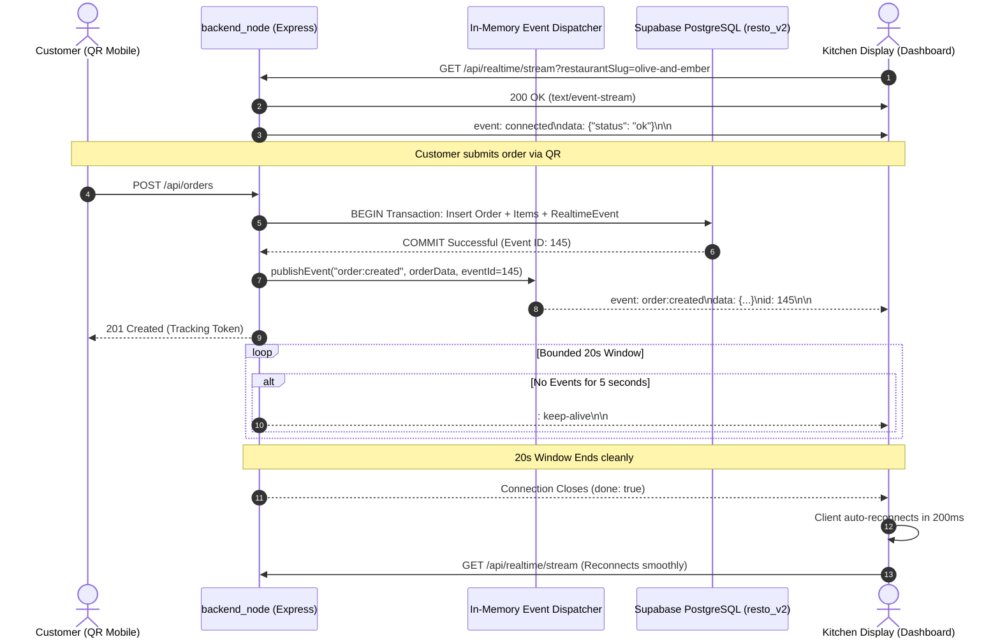

# RESTO V2 — Real-Time Streaming & Event Synchronization Architecture

**Document Version:** 1.0.0 (Phase 2 Real-Time Design)  
**Date:** 2026-11-03  
**Systems Architect:** Principal Real-Time Systems & Distributed Messaging Specialist  
**Target Module:** `backend_node/src/modules/realtime/`  
**Protocol:** Server-Sent Events (SSE) via HTTP/1.1 & HTTP/2  
**Status:** PHASE 2 APPROVED REAL-TIME SPECIFICATION

---

## 1. Executive Summary

Real-time synchronization ensures that when a customer places an order, the kitchen display chime sounds instantly (< 200ms), and when the chef marks food ready, the customer's phone updates without manual page refreshes.

In `backend_node`, real-time is built on a **Durable Event-Outbox Architecture**:
1. **Durable Persistence:** Every mutation (order creation, status update, table change, payment) writes an immutable record to `resto_v2.realtime_events` inside the primary database transaction.
2. **In-Memory Dispatcher:** Events are immediately fanned out to active SSE subscriber connections in memory.
3. **Cursor-Based Catch-Up:** If a mobile customer walks through a Wi-Fi dead zone, their client automatically presents its last received `eventId` to `/api/realtime/sync`, retrieving and applying all missed events in exact chronological order.

---

## 2. Event-Driven Real-Time Topology



---

## 3. Core Architecture Components

### 3.1 Bounded Stream Lifetime & Thread Cycling
In Node.js, event-driven I/O allows handling thousands of concurrent idle sockets without OS thread overhead. However, intermediate edge proxies (Cloudflare, Render edge router, corporate firewalls) often kill long-idle sockets abruptly.
- **Stream Lifetime:** Each SSE connection runs for a bounded window of **20 seconds** (`SSE_MAX_STREAM_DURATION_MS = 20000`).
- **Clean Rotation:** When the 20 seconds elapse, the server closes the HTTP response cleanly.
- **Transparent Reconnection:** The frontend client (`dashboard/src/services/realtimeService.ts`) detects stream closure and immediately re-establishes the connection within **200 milliseconds**.
- **Heartbeat:** Every 5 seconds of inactivity, the server emits a comment frame:
  ```text
  : keep-alive\n\n
  ```

### 3.2 Durable Event Store (`resto_v2.realtime_events`)
All domain events are committed to PostgreSQL to guarantee that no event is lost if a Node.js process restarts:
```sql
CREATE TABLE resto_v2.realtime_events (
    id BIGINT GENERATED ALWAYS AS IDENTITY PRIMARY KEY,
    restaurant_id VARCHAR(64) NOT NULL REFERENCES resto_v2.restaurants(id) ON DELETE CASCADE,
    event_type VARCHAR(50) NOT NULL,
    entity_type VARCHAR(50) NOT NULL,
    entity_id VARCHAR(64) NOT NULL,
    payload JSONB NOT NULL DEFAULT '{}'::jsonb,
    created_at TIMESTAMPTZ NOT NULL DEFAULT clock_timestamp()
);
```

### 3.3 Event Bus & Memory Subscriber Dispatcher
[`backend_node/src/modules/realtime/bus.ts`](file:///Users/akashlodhi/Downloads/RESTO/backend_node/src/modules/realtime/):
```typescript
type SSEClient = {
  id: string;
  restaurantId: string;
  targetOrderId?: string;
  response: Response;
};

class RealtimeEventBus {
  private clients = new Map<string, SSEClient>();

  public registerClient(client: SSEClient) {
    this.clients.set(client.id, client);
  }

  public removeClient(clientId: string) {
    this.clients.delete(clientId);
  }

  public broadcast(restaurantId: string, event: RealtimePayload, targetOrderId?: string) {
    const frame = `event: ${event.type}\nid: ${event.id}\ndata: ${JSON.stringify(event.payload)}\n\n`;
    for (const client of this.clients.values()) {
      if (client.restaurantId !== restaurantId) continue;
      if (targetOrderId && client.targetOrderId && client.targetOrderId !== targetOrderId) continue;
      client.response.write(frame);
    }
  }
}

export const realtimeBus = new RealtimeEventBus();
```

---

## 4. Real-Time Event Catalog & Routing

| Event Name | Trigger Source | Payload Contents | Target Store / UI Handler |
|---|---|---|---|
| `order:created` | Customer places order via QR | Full order record + items + breakdown | `useOrderStore` (New order banner + chime) |
| `order:updated` | Staff transitions status (Accepted, Prep, Ready, Served) | Order ID, new status, timestamps | `useOrderStore` & Customer tracking view |
| `order:completed` | Final payment received | Order ID, settlement time | `useOrderStore` & Daily sales tally |
| `table:updated` | Table occupancy toggled or auto-released | Table ID, occupancy status, active orders | `useTableStore` |
| `payment:received`| Payment record created | Payment ID, method, amount, reference | `usePaymentStore` |
| `service:requested`| Customer clicks "Call Waiter" / "Request Bill" | Table ID, request type, note, timestamp | `useWaiterRequestStore` (Urgent alert) |
| `service:resolved` | Staff marks service request handled | Request ID, resolved timestamp | `useWaiterRequestStore` |

---

## 5. Offline Recovery & Catch-Up Synchronization

When a client loses network connectivity (e.g. mobile device switching from Wi-Fi to cellular):
1. **Client Tracking:** The frontend tracks the highest event ID received in `lastEventId`.
2. **Reconnection Catch-Up:** Upon reconnection, the client issues:
   ```http
   GET /api/realtime/sync?restaurantSlug=olive-and-ember&lastEventId=142 HTTP/1.1
   Authorization: Bearer <token>
   ```
3. **Bounded Index Scan:** The backend executes:
   ```sql
   SELECT id, event_type, payload, created_at 
   FROM resto_v2.realtime_events 
   WHERE restaurant_id = $1 AND id > $2 
   ORDER BY id ASC LIMIT 100;
   ```
4. **Ordered Replay:** Missed events are returned in JSON and applied sequentially to local Zustand stores.
5. **Deduplication:** A sliding-window `Set<string>` on the client prevents duplicate toasts or state glitches if an event was already processed.

