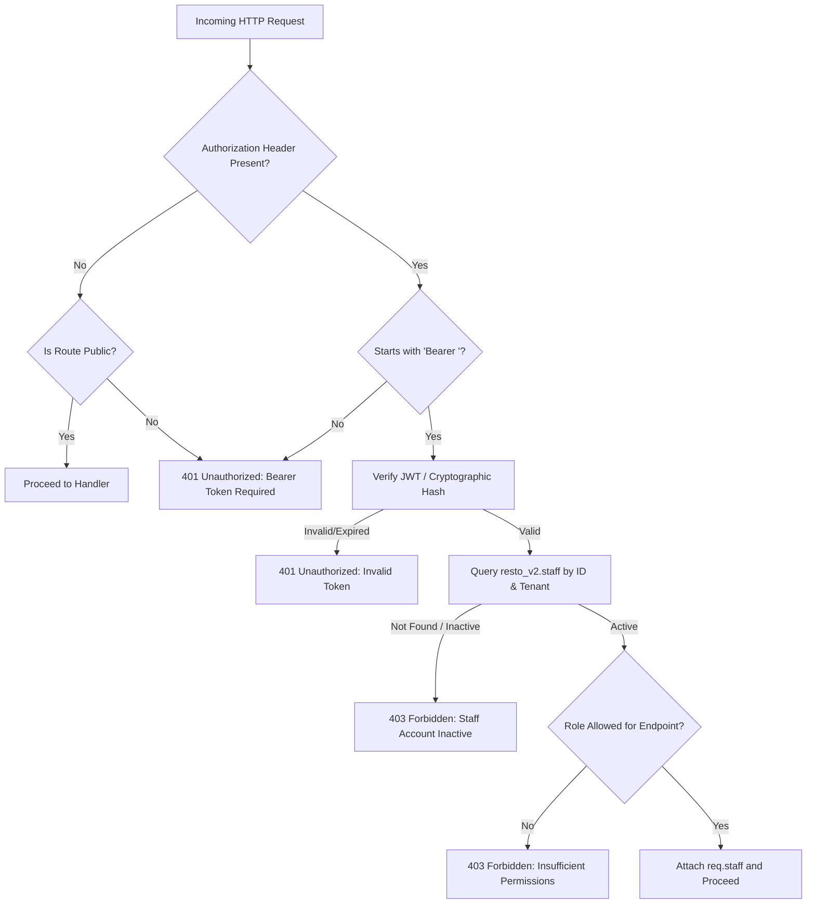

# RESTO V2 — Security Architecture & Threat Mitigation Specification

**Document Version:** 1.0.0 (Phase 2 Security Design)  
**Date:** 2026-11-03  
**Security Architect:** Principal Application Security Engineer & Production SRE  
**Scope:** Complete defense-in-depth security model for `backend_node/` operating against `resto_v2` schema.  
**Compliance Target:** OWASP API Security Top 10

---

## 1. Executive Summary

A critical objective of RESTO V2 is to **permanently eliminate the catastrophic security flaws identified in the older Express prototype backup** while maintaining strict zero-trust operational standards:

### Key Security Remediation:
- **Zero Admin Fallback:** In the old Express prototype, invalid tokens triggered catch blocks that automatically granted `restaurant_admin` rights. In V2, **any invalid, expired, or missing token strictly returns HTTP 401 Unauthorized**.
- **No Hardcoded Password Bypasses:** Hardcoded strings like `"BonAppetit2026"` have been eradicated. All credentials are cryptographic hashes verified against `resto_v2.staff`.
- **Elimination of Shared In-Memory Leakage:** All state is persisted to PostgreSQL under tenant boundaries.

---

## 2. Authentication & Authorization Subsystem



### 2.1 Role-Based Access Control (RBAC) Matrix

| Endpoint Group | `super_admin` | `restaurant_admin` | `manager` | `chef` | `waiter` | Public |
|---|:---:|:---:|:---:|:---:|:---:|:---:|
| **Public Catalog (`/menu`, `/restaurants/info`)** | ✅ | ✅ | ✅ | ✅ | ✅ | ✅ |
| **Table Availability (`/tables/availability`)** | ✅ | ✅ | ✅ | ✅ | ✅ | ✅ |
| **Order Placement (`POST /orders`)** | ✅ | ✅ | ✅ | ✅ | ✅ | ✅ |
| **Order Tracking (`/orders/:id/tracking`)** | ✅ | ✅ | ✅ | ✅ | ✅ | With Token |
| **Live Orders View (`GET /orders`)** | ✅ | ✅ | ✅ | ✅ | ✅ | ❌ |
| **Accept / Prepare / Ready (`PATCH /orders/:id/status`)**| ✅ | ✅ | ✅ | ✅ | ✅ | ❌ |
| **Serve Order (`PATCH /orders/:id/status` -> served)** | ✅ | ✅ | ✅ | ❌ | ✅ | ❌ |
| **Floor Table Management (`POST/PUT/DELETE /tables`)** | ✅ | ✅ | ✅ | ❌ | ❌ | ❌ |
| **Menu Editing (`POST/PATCH/DELETE /menu`)** | ✅ | ✅ | ✅ | ❌ | ❌ | ❌ |
| **Image Uploads (`POST /upload`)** | ✅ | ✅ | ✅ | ❌ | ❌ | ❌ |
| **Payment Settlement (`POST/PATCH /payments`)** | ✅ | ✅ | ✅ | ❌ | ❌ | ❌ |
| **Staff Invitations & Roles (`/staff`)** | ✅ | ✅ | ❌ | ❌ | ❌ | ❌ |
| **Restaurant Settings (`PUT /settings`)** | ✅ | ✅ | ❌ | ❌ | ❌ | ❌ |

---

## 3. Defense-in-Depth Implementation Specifications

### 3.1 Strict Bearer Token Middleware (`middleware/auth.ts`)
```typescript
export const requireStaff = async (req: Request, res: Response, next: NextFunction) => {
  const authHeader = req.header('authorization');
  if (!authHeader?.startsWith('Bearer ')) {
    return next(new AppError(401, 'A valid Bearer access token is required', 'UNAUTHENTICATED'));
  }

  const token = authHeader.slice(7).trim();
  if (!token) {
    return next(new AppError(401, 'A valid Bearer access token is required', 'UNAUTHENTICATED'));
  }

  try {
    const staff = await staffService.verifyStaffToken(token);
    if (!staff || !staff.isActive) {
      return next(new AppError(403, 'Staff account is inactive or revoked', 'FORBIDDEN'));
    }
    req.staff = staff;
    next();
  } catch (error) {
    // STRICT SECURITY: Never fall back to mock admin!
    return next(new AppError(401, 'Invalid or expired access token', 'UNAUTHENTICATED'));
  }
};
```

### 3.2 BOLA / IDOR Prevention on Customer Tracking
Customer tracking allows diners to monitor order progress without signing in. To prevent attackers from enumerating sequential order IDs and harvesting names/phone numbers:
1. **HMAC-SHA256 Tokenization:** Upon order creation, a 32-character tracking token is generated using `TRACKING_TOKEN_SECRET`:
   ```typescript
   export function generateTrackingToken(restaurantId: string, idempotencyKey: string): string {
     const raw = `${restaurantId}:${idempotencyKey}:${env.TRACKING_TOKEN_SECRET}`;
     const digest = crypto.createHash('sha256').update(raw).digest('hex').slice(0, 32);
     return `tok-${digest}`;
   }
   ```
2. **One-Way Hash Verification:** Only the SHA-256 hash is saved to `resto_v2.orders.tracking_token_hash`.
3. **Constant-Time Verification:** Tracking queries must supply `?accessToken=<token>`. Verification uses `crypto.timingSafeEqual` to prevent timing attacks.

### 3.3 Server-Side Price & Tax Enforcement
Client payloads provide item IDs and quantities. **Client-provided prices are completely discarded**:
1. Dish unit prices are queried directly from `resto_v2.menu_items` via `MenuItemRepository`.
2. Add-on prices are verified against item `addons` JSONB definitions.
3. 2.5% CGST and 2.5% SGST (5% total GST) are calculated server-side using decimal arithmetic.

### 3.4 Multi-Tenant Data Isolation
- Every database query executed by `backend_node` explicitly includes `restaurant_id = $1`.
- Tenant IDs are bound to verified staff credentials. Staff members cannot access data belonging to another restaurant.

### 3.5 Rate Limiting & Denial of Service (DoS) Protection
- **Global Rate Limiter:** 300 requests per 15-minute window per IP address using `express-rate-limit`.
- **Authentication Rate Limiter:** 20 login attempts per 15-minute window to block brute-force password guessing.
- **Payload Size Limiter:** Request body parser capped at `256kb` (`express.json({ limit: '256kb' })`) to prevent heap saturation attacks.

### 3.6 Secure Object Storage Uploads (`modules/uploads/`)
- Capped at **5 MB** per upload.
- MIME type strictly validated: `image/jpeg`, `image/png`, `image/webp`.
- Filename randomized using UUID (`crypto.randomUUID()`) to prevent directory traversal and path collision.
- Uploaded via Supabase Storage SDK to `resto-media/menu-items/` with public read access.

---

## 4. Secret Management & Runtime Environment

- **Zero Secret Exposure:** The Supabase `SERVICE_ROLE_KEY`, `DATABASE_URL`, and `TRACKING_TOKEN_SECRET` exist only in secure server environment variables.
- Neither the customer frontend nor dashboard repository contains backend service secrets.
- Startup logger masks passwords and database connection strings.
